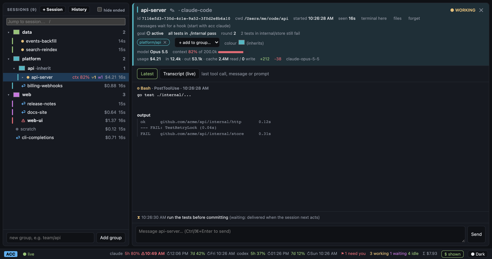

<p align="center"></p>

# ACC — Agents Control Centre

[Documentation](https://acc.emdzej.pl) · [Getting started](https://acc.emdzej.pl/guide/)

One binary to monitor coding-agent sessions (Claude Code and OpenCode), group
and colour them, and send messages back into them. Daemon, web dashboard, TUI, CLI and agent hook handler
are all `acc`.



## Quick start

Download a binary for macOS or Linux from
[Releases](https://github.com/emdzej/acc/releases), or build it (Go 1.27+):

```sh
go install github.com/emdzej/acc/cmd/acc@latest   # or, in a checkout: go install ./cmd/acc
acc serve                   # daemon on 127.0.0.1:7317 (keep running)
acc setup                   # merge hooks into detected agents (shows plan, asks first)
acc open                    # web dashboard      |  acc tui   # terminal dashboard
acc new ~/Projects/app      # start a Claude session in a new terminal window
```

`acc tui` embeds the server when none is running (`--serve=auto|always|never`),
so one command is enough; the embedded server stops when you quit.

Restart agent sessions after `acc setup` so they load the hooks.

## Commands

| Command | Purpose |
|---|---|
| `acc serve [--addr]` | API, SSE stream, embedded web UI; replays spooled events on start |
| `acc setup [--agent claude-code\|opencode] [--scope user\|project] [--dry-run] [--uninstall]` | Install/remove ACC hooks (Claude Code) or plugin (OpenCode); merges, backs up, idempotent |
| `acc tui [--serve]` | Full-screen panel dashboard (`?` for keys) |
| `acc open [--print]` | Open the dashboard, signing in with the local token |
| `acc ls` | List sessions |
| `acc new [dir] [-a agent] [-t title] [-g group] [-p prompt] [--tmux]` | Start a session in a terminal window (Ghostty, Terminal, iTerm, custom), optionally hosted in tmux; `~/.acc/config.json` |
| `acc attach <session>` | Bring a session ACC started back on screen |
| `acc resume <session>` | Bring a session back, or reopen an ended one in a new window |
| `acc history [filter]` / `--add <id>` | Every session Claude Code and OpenCode have on record; add one to ACC |
| `acc term <session>` / `acc files <session>` | Terminal / Finder in the session's directory |
| `acc forget <session>…` / `--ended` | Remove sessions from ACC (the agent keeps them) |
| `acc claude [args…]` | Run `claude` with ACC's message channel enabled |
| `acc rename <session> <title>` / `--clear` | Session title in ACC |
| `acc send <session-prefix> <msg>` / `acc send -g <group> <msg>` | Message a session or group; a `/command` runs in OpenCode sessions and is typed into Claude sessions ACC started |
| `acc group ls\|set <path> [#hex\|inherit]\|rm <path>\|add <path> <sess>…\|remove` | Group tree and colours |
| `acc color <session> <#hex\|none>` | Session's own colour |
| `acc doctor` | Check token, daemon and agent hooks |
| `acc hook <agent>` / `acc mcp` / `acc statusline` | Called by the agent (hidden) |

## Dashboard model

- **Groups** form a tree of any depth, addressed by path (`platform/backend`).
  Filtering and group messages include subgroups; deleting removes the subtree.
- **Colours**: a session's own colour, else its group's, else the nearest
  ancestor group's. Groups without a colour inherit.
- **Sessions** list main sessions only; subagents (Claude Code's Agent/Task
  tool) nest under their session and can be opened in their own panel.
- **Attention**: `⚠` permission needed, `?` question/plan approval, `⏎` turn
  finished and awaiting input.
- **Session panel** shows the latest tool call + output, message or prompt.
  Live transcript tracking is opt-in (`t` in the TUI, toggle in the web UI).
- **Usage**: cost, tokens, cache and lines changed, read from Claude Code's
  transcript (`cost-state` records) or OpenCode's session totals.
- **Plan limits**: 5-hour and weekly windows from Claude Code's status line,
  with a warning when the current pace hits a limit before it resets.
- **Goals**: a session's `/goal` with its status, round and the judge's verdict.

## How messages reach a session

**Instantly, over a channel.** `acc setup` registers `acc mcp`, a Claude Code
[channel](https://code.claude.com/docs/en/channels-reference) server. In a
session started with the channel enabled, it claims messages the moment they
are sent and pushes them in, which wakes an idle session:

```sh
acc claude                      # = claude --dangerously-load-development-channels server:acc
# or once, in ~/.zshrc:
alias claude='claude --dangerously-load-development-channels server:acc'
```

Claude Code enables channels per launch only (no settings key) and asks you to
confirm the development channel each time. Channels need `channelsEnabled` on
Team/Enterprise orgs and aren't available on Bedrock, Vertex or Foundry.
Sessions with a live channel show ⚡ in the session panel.

**Otherwise, at the next hook.** Without a channel, messages wait in ACC and
are collected by the session's next hook that makes the agent act on them:
`UserPromptSubmit` and `PostToolUse` (added as `additionalContext` inside the
running turn) and `Stop` (which blocks the stop with the message as the
reason, so the agent continues). An agent idle at its prompt receives the
message when it next acts. Either way delivery is at-most-once, and subagents
never collect messages.

**OpenCode** needs no flag: the ACC plugin follows ACC's live stream and
hands messages to OpenCode as prompts (or `/commands`), which wakes idle
sessions.

Hooks never break the agent: they time out after 2 seconds, always exit 0,
and spool undeliverable events to `~/.acc/spool/`.

Full documentation: https://acc.emdzej.pl

## State & auth

`~/.acc/` (override with `ACC_HOME`): `acc.db` (SQLite), `token` (0600),
`spool/`. Clients use `ACC_SERVER` / `ACC_TOKEN` to target another daemon.
Local mode is loopback-only with a bearer token. `acc serve --addr 0.0.0.0:7317`
opens the dashboard to your network after you confirm: sign in with
`~/.acc/remote_key` (`--auth key`, default) or no auth (`--auth none`),
optionally over TLS (`--tls-cert/--tls-key`). Internet-facing hosted mode will
use OIDC.

## Layout

```
cmd/acc            entrypoint
internal/cli       cobra commands
internal/server    HTTP API, auth, SSE hub, serves web/dist
internal/store     SQLite schema and queries
internal/hook      agent hook handler + spool
internal/setup     adapter interface, Claude Code and OpenCode adapters, safe config writes
internal/opencode  OpenCode event translation
internal/transcript transcript tailing, latest-activity and usage extraction
internal/tui       Bubble Tea panel dashboard
web/dist           embedded dashboard (vanilla JS)
```
