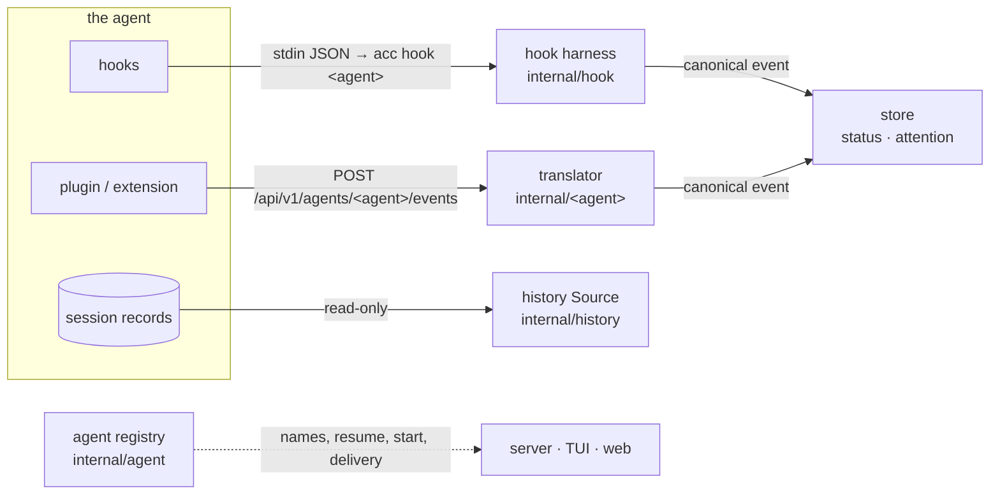

# Adding an agent

ACC supports an agent (a coding harness such as Claude Code or OpenCode)
through a few small, separate pieces. This page explains how they fit
together and walks through adding one. [Agent integrations](/docs/integrations)
describes what each supported agent's integration does.

## What "supported" means

An agent can be supported at several levels. Each level works on its own,
so an integration can start small:

| Level | What the user gets | What ACC needs from the agent |
|---|---|---|
| **Monitoring** | the session in the tree, its status (*working*, *awaiting input*, *needs permission*), tool activity | lifecycle events: hooks, or a plugin API |
| **History** | the session in [History](/guide/history#history), before and after ACC saw it | its session records on disk (files or a database) |
| **Resume** | **↻ resume** for ended sessions | a command line that continues a session by ID |
| **Start** | **+ Session** with this agent | a command line that starts a session *with an ID ACC chose* |
| **Messages** | `acc send` and the composer reach the session | a hook whose output injects text, or a plugin that can prompt |
| **Usage** | cost and tokens | totals in its records or events |

## How it fits together

Every agent's events end up as one vocabulary of **canonical events**,
named after Claude Code's hooks. The store, the dashboards and the API only
know these, so a new agent needs no changes there.



### Canonical events

An integration's job is mostly to map the agent's events onto these names.
The store derives the session's status and "needs you" state from them
(`statusFor` and `attentionFor` in `internal/store/store.go`):

| Event | Status | Attention | Send it when |
|---|---|---|---|
| `SessionStart` | active | | a session starts or is resumed (carries `cwd`) |
| `UserPromptSubmit` | working | cleared | a prompt was submitted (`message` = the prompt) |
| `PreToolUse` | working | cleared, or *question* for question tools | a tool is about to run (`tool_name`, `summary`) |
| `PostToolUse` / `PostToolUseFailure` | working | cleared | a tool finished (`message` = output) |
| `PermissionRequest` | waiting | *needs permission* | the agent waits for approval (`tool_name`, `summary`) |
| `PermissionReplied` | working | cleared | the approval was answered |
| `Question` / `QuestionAnswered` | waiting / working | *question* / cleared | the agent asks the user something (a form, a choice) |
| `Notification` | waiting | by `notification_type`: `permission_prompt`, `idle_prompt`, `elicitation_dialog`, anything else = *notice* | the agent wants attention |
| `PreCompact` | working | | context is being compacted |
| `Stop` | idle | *awaiting input* | the turn finished (`message` = the last reply) |
| `SubagentStart` / `SubagentStop` | | | a subagent starts or stops (`agent_id`, `agent_type`) |
| `SessionEnd` | ended | cleared | the session ended (`message` = reason) |

Pick the event whose *meaning* matches, not the one with the closest name.
Two examples: pi's `agent_settled` (truly idle) maps to `Stop`, and its
`agent_end` doesn't, since queued messages can follow it. An agent that has
no "permission answered" event can leave attention to the next `PreToolUse`,
which clears it.

The event model is `model.Event` (`internal/model/model.go`). Besides the
name and session ID, fill `cwd`, `transcript_path` when there is one, and a
one-line `summary` (command, file, prompt) for the activity view.

## Integration styles

ACC talks to agents in one of two ways. Use whichever the agent offers;
prefer a plugin when the agent can run one, because it can deliver messages
immediately.

### Hook commands

The agent runs a command for each event, passing a JSON payload on stdin
(Claude Code, Codex, Copilot CLI and Gemini CLI all work this way). ACC's
command is `acc hook <agent>`. It:

1. parses the payload into a canonical event,
2. posts it to `POST /api/v1/events`, asking for queued messages when the
   event can inject them (`deliver`),
3. prints the messages in the agent's injection format on stdout, and
4. never breaks the agent: when the daemon is down, the event is
   spooled to `~/.acc/spool` and replayed when `acc serve` starts, and the
   hook exits 0.

Each agent is one entry in `harnesses` (`internal/hook/hook.go`):

```go
var harnesses = map[string]harness{
	AgentClaude: {parseClaude, claudeOutput...},
	"codex":     {parseCodex, codexOutput},
}
```

- **`parse(raw) (model.Event, error)`** fills the event from the payload.
  It sets `Deliver` only on events whose output the agent turns into input,
  for example Claude Code's `UserPromptSubmit`, `PostToolUse` and `Stop`.
  Don't set it on `SessionStart`: its output lands with no turn to act on it.
- **`output(ev, msgs) any`** is the JSON the hook prints. Claude Code takes
  `additionalContext` inside a turn, and `{"decision": "block", "reason": …}`
  on `Stop`, which makes it continue with the message.

Hook commands use the absolute path of the `acc` binary (hooks run with a
minimal environment) and read the token from `~/.acc/token`, so there are
no secrets in the agent's config.

### Plugins and extensions

The agent loads a script into its own process (OpenCode plugins, pi
extensions). ACC embeds the script in the binary
(`internal/setup/<agent>_plugin.js`, via `//go:embed`), and `acc setup`
writes it into the agent's plugin directory. The script then uses ACC's
HTTP API:

| Call | Purpose |
|---|---|
| `POST /api/v1/agents/<agent>/events` | forward the agent's events *raw*; a translator in Go maps them, so changing the mapping needs no reinstall |
| `GET /api/v1/stream` | server-sent events; a `messages` event means something was queued |
| `POST /api/v1/sessions/{id}/claim` | take the session's queued messages, exactly once |
| `GET /api/v1/sessions` | which sessions exist (to claim for the ones this process hosts) |

The rules a plugin follows:

- **Starts with the marker** `// acc-managed:`. Setup only overwrites or
  removes files that carry it, and refuses to touch any other file there.
- **Finds ACC at run time**: `ACC_HOME`, `ACC_SERVER` and `ACC_TOKEN` from
  the environment, else the values setup baked in (`__ACC_HOME__`,
  `__ACC_SERVER__`). It reads the token file at run time; the token never goes
  into the script.
- **Is best-effort**: short timeouts and swallowed errors. When ACC isn't
  running, the agent must carry on unaffected.
- **Claims only its own sessions**, so a message never goes to the wrong
  process when several instances run.
- **Prefixes delivered prompts** so the model knows they came from the
  operator through ACC.

The translator lives in its own package (see `internal/opencode`): a pure
`Translate(raw) Result` that returns a canonical event plus side data
(title, usage, model, goal), with table tests over captured payloads. The
server endpoint (`internal/server/opencode.go`) records the results.

## Step by step

The examples use a made-up agent `acme`.

### 1. Register it

Add an entry to the registry in `internal/agent/agent.go`:

```go
{
	ID: "acme", Name: "Acme", Short: "acme",
	Command:    "acme",
	ResumeArgs: func(id string) []string { return []string{"--resume", id} },
	StartArgs: func(s Start) []string {
		args := []string{"--session-id", s.SessionID}
		if s.Prompt != "" {
			args = append(args, s.Prompt)
		}
		return args
	},
	Delivery:    DeliverHook,
	Unconnected: "messages wait for a hook (acc setup --agent acme)",
},
```

- Leave `ResumeArgs` nil if the agent can't resume a session by ID.
- Leave `StartArgs` nil unless the agent accepts **a session ID chosen by
  ACC**. ACC registers the session before the window opens, so title, group
  and colour apply from the start, and the session's events must arrive
  under that ID.
- `Delivery` tells the UIs how messages arrive: `hook` (with the next
  injecting hook), `plugin` (immediately), or `none` (only by typing into
  sessions ACC hosts in tmux).
- `QueueSlash` is for agents whose plugin can run `/commands`. Without it,
  ACC types slash commands into tmux-hosted sessions instead.

Users can override the command in `~/.acc/config.json` under
`launch.commands.acme`; ACC appends the arguments above. With that, the
server's start and resume endpoints, the agent picker in **+ Session**, the
resume buttons and the delivery hints all work, and `GET /api/v1/agents`
lists the agent.

### 2. Install the integration

Implement `setup.Adapter` in `internal/setup/acme.go`:

```go
type Adapter interface {
	Name() string                   // the agent ID
	Detect() (Installation, bool)   // installed? which binary and version
	Plan(opts Options) ([]Change, error)
	PlanUninstall(opts Options) ([]Change, error)
}
```

`Plan` returns full-file rewrites (`Change{Path, Old, New}`); `acc setup`
shows them as a diff, asks, then backs up and writes each one atomically.
The adapter must:

- **merge, never overwrite**: only add, replace or remove entries ACC owns
  (hooks whose command ends in ` hook acme`, or a file with the marker), and
  keep the user's other settings byte for byte where the format allows,
- **be idempotent**: a second run plans no changes,
- **support both scopes** where the agent has them: user (default) and
  project (`--project-dir`),
- write the absolute `acc` path from `opts.Bin`.

Add the adapter to `Adapters()` in `internal/setup/setup.go`, and test
install, reinstall (no-op) and uninstall against fixture config files (see
`claude_test.go`).

### 3. Translate its events

For hook agents, add a `harnesses` entry (see [Hook commands](#hook-commands)).
For plugin agents, write the plugin, a translator package and a
`POST /api/v1/agents/acme/events` endpoint (see
[Plugins and extensions](#plugins-and-extensions)). Either way, test the
mapping with real payloads captured from the agent.

### 4. Read its history

Add a `Source` to `Sources` in `internal/history/history.go`:

```go
{"acme", func(ctx context.Context, x *Index, limit int) ([]model.PastSession, error) {
	return x.Acme(AcmeDir()), nil
}},
```

Fill `model.PastSession` with the ID, directory, title (the agent's own
title, else the first prompt), start and last-active times and, if the
agent records it, usage. Read only: open databases with `?mode=ro`, never
write to the agent's files. Agents that keep one file per session should
read each file through `(*Index).File`, which caches the result until the
file changes, because History rescans on every open.

### 5. Usage and liveness

- **Usage from a transcript**: add a reader to `usageReaders` in
  `internal/server/usage.go`. It is called, throttled, as events arrive with
  `transcript_path` set. Plugins can report usage themselves instead.
- **Liveness**: if the agent keeps a registry of running sessions (as
  Claude Code does), teach `knowsRunning` and `runningPID` in
  `internal/server/history.go` to read it. ACC then refuses to resume a
  session that is still running in another terminal, and marks sessions
  whose process vanished as ended. Without one, ACC trusts the session's
  last status.

### 6. Document and test

- Add the agent's section to [Agent integrations](/docs/integrations): what
  setup installs, the event mapping, how messages arrive and what isn't
  covered.
- Add a session of the agent to `scripts/demo.sh` if the dashboards show
  something new.
- Run it for real: `acc setup --agent acme`, start a session, and check
  status changes, a permission prompt, a message, History, resume and usage.

## Where things live

| Piece | Location |
|---|---|
| Registry: names, start and resume command lines, delivery | `internal/agent` |
| Command line overrides, terminals, tmux | `internal/launch` (`launch.commands`) |
| Setup adapters and plugin sources | `internal/setup` |
| Hook harnesses (`acc hook <agent>`) | `internal/hook` |
| Plugin event translators | `internal/<agent>`, endpoint in `internal/server` |
| History sources | `internal/history` |
| Transcript usage readers | `internal/server/usage.go` |
| Status and attention from canonical events | `internal/store/store.go` |
