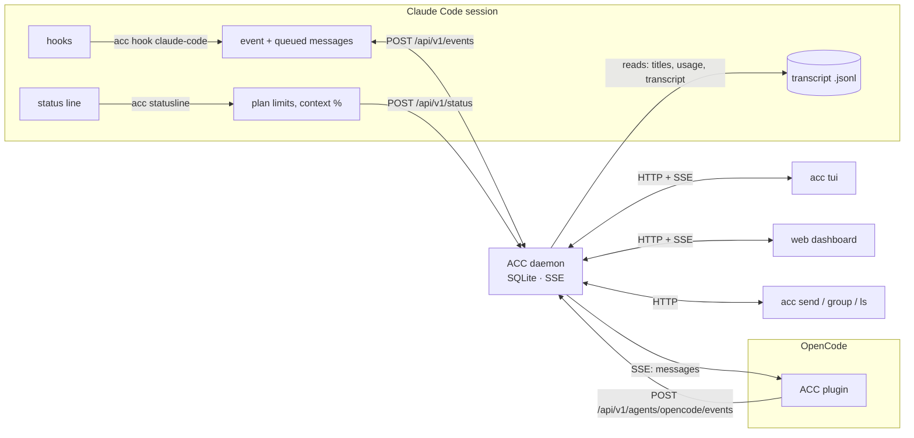

# How it works

ACC is one Go binary with several roles. The daemon (`acc serve`, or embedded
in `acc tui`) owns a SQLite database and serves the HTTP API, a live event
stream and the web dashboard. Claude Code, Codex, Copilot CLI and Gemini CLI talk to it through hooks,
OpenCode and pi through ACC's plugin and extension, and the dashboards and CLI are clients of
the same API.

## Data flow

1. **Hooks report events.** Each Claude Code hook runs `acc hook claude-code`.
   It reads the hook's JSON from stdin, normalises it (session, event, tool,
   subagent, a one-line summary) and posts it to the daemon with a 2-second
   timeout.
2. **The reply carries messages.** If the event can inject text into the model
   inside a turn (prompt submit, after a tool) or can continue one (stop), the daemon claims the
   session's queued messages in the same transaction and returns them. The
   hook prints them in Claude Code's injection format.
3. **The status line reports limits.** `acc statusline` receives Claude Code's
   status line feed, forwards plan windows and context fill, and prints a
   compact status line, or the user's own one, chained.
4. **The daemon reads transcripts** for what hooks don't carry: `/rename`
   titles, `/goal` records, usage (`cost-state` records), and the live
   transcript view.
5. **OpenCode reports through its plugin.** The plugin forwards OpenCode's
   bus events as they are; the daemon translates them to the same session
   model. It follows the daemon's event stream and claims messages the
   moment they are queued.
6. **Dashboards subscribe** to a Server-Sent Events stream and refetch on
   change. The daemon only publishes when something actually changed.

## Failure handling

Hooks must never break the agent:

- every hook exits 0, whatever happens;
- if the daemon is unreachable, the event is written to `~/.acc/spool/` and
  replayed when the daemon next starts. Spooled events never claim messages;
- the status line command posts in parallel with rendering, with a 500 ms cap,
  and still prints when ACC is down.

## Storage

Everything lives in `~/.acc/` (override with `ACC_HOME`):

| Path | Contents |
|---|---|
| `acc.db` | SQLite (WAL): sessions, subagents, events, groups, messages, plan usage |
| `token` | the local API token, mode 0600 |
| `spool/` | events recorded while the daemon was down |
| `serve.log` | log of the server embedded in `acc tui` |
| `tui.json` | TUI display preferences |

Schema changes are versioned migrations (`PRAGMA user_version`). Table
rebuilds run with foreign keys off, so group memberships survive them.

## Single binary

The web dashboard is plain HTML and JavaScript embedded with `go:embed`.
SQLite is the pure-Go `modernc.org/sqlite` driver, so the binary needs no
cgo and has no runtime dependencies.
